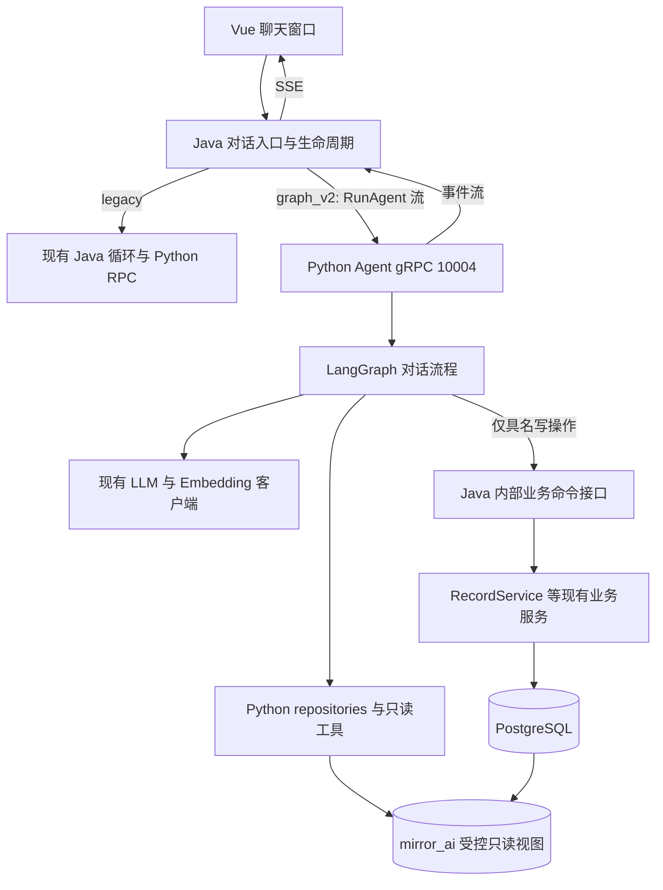
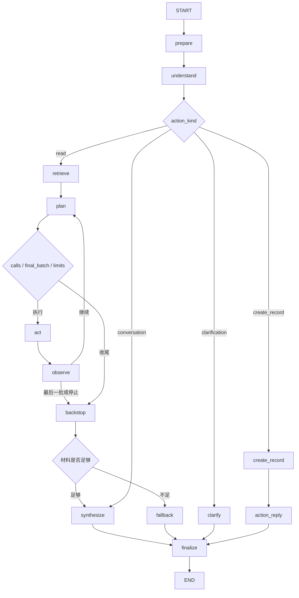

# Mirror AI 对话架构 v2：Python 管 AI 查询与编排，Java 管接入和业务写入

> 日期：2026-10-20（Asia/Shanghai）
> 状态：历史实施设计；2026-10-21 的接线更新见下方说明。
> 范围：对话助手。分类、画像生成、上传消化、审核、普通页面 CRUD 保持现有业务归属。
> 配套实施清单：[Implementation Plan](superpowers/plans/2026-10-20-ai-agent-implementation.md)。
> 本文取代原迁移草案作为**新版对话**的实施依据；原文 `2026-10-20-chat-agent-langgraph-migration.md` 保留作历史参考。本文中的文件、接口和表，除“现状”明确列出的以外，都是拟新增或拟修改项。

> **实现更新（2026-10-21）：** graph_v2 的聊天入口现已通过 gRPC `prepare_tools` 接收 Java 注册表中的待确认工具，并用 `prepare_action` 事件请求 Java 创建一张操作卡。记录、待办、记忆候选、成长调整都走现有 `PREPARE_WRITE` 执行器和前端 `action_proposal`/`action_status` SSE；用户确认仍由 Java 卡片接口处理。普通聊天请求不再携带 `create_record` 直接写 grant。本文第10节描述的是早期设计中的直接创建路径，不是当前普通聊天路径。Java/Vue 实际联调仍需验收，legacy 仍是默认引擎。

## 1. 先读这一页：最终决定

采用“Java 统一入口 + Python 完整对话 Agent + Python AI 只读数据访问 + Java 业务写接口”。

- Java 继续接收 `/api/mirror/chat`，完成鉴权、会话管理、配置解密、聊天消息持久化、SSE 转发。
- Python 自己加载词典和对话历史，执行意图理解、向量化、检索、读工具循环、回答生成。
- Python 使用专用只读账号访问受控数据库视图，不读取 `user_settings`、用户密码、文件二进制。
- 真正的新增、修改、删除通过 Java 的具名业务接口执行，不向模型开放通用 SQL 或通用 CRUD。
- 首版只增加 `create_record` 写工具；更新、删除和自动审核不开放。
- Python 保持进程无状态：每轮临时状态在内存，聊天和业务事实由 Java 写入数据库；首版不启用 checkpointer。
- 旧版继续工作；通过请求开始时确定的引擎开关逐步切换。数据库、普通业务服务和前端聊天入口共用。
- 新版查询过程不经过 Java 检索 RPC，也不通过本机 gRPC 调用 Embedding。Java 写接口不能同步等待 Python 推理。

**首版不做：** 新网关、前端直连 Python、消息队列、独立工具微服务、多 Agent、并行多路融合、跨请求暂停恢复、删除或覆盖确认卡、历史数据自动补授权。

## 2. 为什么采用这个边界

原结构适合“Java 给材料，Python 返回推理结果”。现在需要模型多步查询并根据结果继续决策，AI 查询分散在两个语言中会增加接线和排错成本。

只搬循环而保留全部 Java 查询，改动少但 Python 仍频繁请求 Java。把业务写入也全部搬到 Python，则会复制已有校验、事务、审核和异步整理规则。本方案把迁移主要限制在 AI 查询与对话控制，同时复用 Java 的业务服务。

代价必须接受：过渡期 Java、Python 各有一套 AI 查询实现；Python 与数据库读模型产生依赖。用受控视图、统一数据契约、同库夹具对照控制这种依赖。旧版退役后才删除 Java 的旧对话查询实现；仍被其他业务使用的 Mapper 和 SQL 不删除。

## 3. 当前代码事实与不能漏掉的规则

| 当前实现 | 实施时的含义 |
|---|---|
| AI `server.py`：同步 gRPC，同一线程池注册多个 service；`config.yml` workers=4 | 新 Agent 使用独立端口和执行池，不挤占旧推理 RPC 的工作线程 |
| `ChatServiceImpl.chat()`：用户消息先落库；检索后调用 Java 工具循环 | 新版不能再次插入用户消息；历史读取必须排除这条当前消息 |
| `ToolOrchestrator.loopAndExecute()`：最多 4 轮；重复指纹、预算、异常停止 | 新图保留这些业务终止语义 |
| `done=true` 且 calls 非空：执行最后一批后结束 | 不允许看到 done 就跳过执行 |
| `format_previous_results()`：摘要非空就不展示 payload | 新版 observation 需要展示关键字段，文件 ID、统计分布不能丢 |
| 现有 `save_item` 调用只读 `VaultService.recall()` | 它不是创建记录工具，不为它增加写入确认 |
| `RecordDTO` 只有 `content` 与默认 false 的 `requestAiProcessing`；正文最多 2000 字 | 首版创建工具不虚构 title、record_date 等未支持字段 |
| `RecordServiceImpl.create()` 默认 `record_only`；授权才发布整理事件 | 聊天创建默认“仅记录”，不自动触发整理或授权长期记忆 |
| `chunks.ai_memory_approved`、`todo_approved`；`profile_snapshots.invalidated` | Python 查询必须保留分别授权、失效过滤；不能仅凭“向量非空”推断可用 |
| Java 词典 query 命中会增加 `query_hit_count` | 只读 Python 返回命中词条 ID，Java 在本轮完成时更新一次 |
| 前端 `src/stores/chat.js` 接受现有 SSE 事件 | 保持事件名，新增字段向后兼容；修正 error 清空已有正文的行为 |

2026-10-20 本次分析中已执行的 Python 基线：365 项，358 通过、7 失败；失败停在 `tests/test_round9.py` 的 `import httpx2`。未验证真实模型 E2E。当前本地 venv 是 Python 3.14.6，Dockerfile 是 Python 3.12；本地 SDK 版本与 `requirements-minimal.txt` 的声明也不完全相同，实施前必须记录并对齐，不能直接引用旧稿“357 项全绿”。

## 4. 调用关系



图中的 ENTRY、COMMAND、BUSINESS 都属于现有 Java 后端，不新增 Java 微服务。VIEWS、业务表在同一数据库。Agent 与旧 RPC 可在一个 Python 进程启动，但使用不同 gRPC server、端口和线程池。

允许 Java 现有异步整理任务继续请求 Python 10003。禁止的是“处理本轮 Python 写工具请求时，同步等待 Python 推理再返回”的等待环，不禁止其他独立任务使用原推理服务。

## 5. 请求生命周期和 ID

### 5.1 外部请求

现有 POST `/api/mirror/chat` 保留。`ChatRequestDTO` 新增可选 UUID `requestId`；前端新版每次用户提交生成一次，重连/重试复用，用户主动再发一遍则生成新值。

Java 从已认证主体取得 user_id，校验会话所有权。一次短事务中完成：确定 session、创建 `agent_runs` 行、插入唯一 user 消息。外部 requestId 缺失时由 Java 生成，兼容旧前端；这种请求跨 HTTP 重试无法保证去重，meta 返回生成值供新版保留。

| 名称 | 创建方 | 作用 |
|---|---|---|
| session_id | Java | 一段聊天，已有语义不变 |
| client_request_id | 前端，旧客户端由 Java 补 | 一次用户提交的去重键 |
| run_id | Java | 一次实际执行，主表唯一；同一提交重试不生成新 run |
| user_message_id | Java | 当前问题的消息行；Python 历史查询的排除边界 |
| call_id | Python 运行器 | 一次工具动作；创建命令固定 UUIDv5(run_id, `create_record:0`) |
| event_seq | Python | 本轮事件从 1 单调增加，Java 防重复消费 |

`UNIQUE(user_id, client_request_id)`：同键同请求返回已有运行状态/已有最终回答，不再运行模型或执行命令；同键不同 question 或外部 sessionId 返回 409。无 sessionId 的首轮使用原始 null 参与 request_hash，不以新生成 sessionId 重新计算。

两个引擎共用接纳结果 `ChatInvocation(userId, sessionId, runId, userMessageId, question)`。legacy只运行现有chat()中“消息已落库之后”的意图/检索/工具/回答部分，不能再次执行resolveSession/insertMessage(user)。已有legacy输出行为保持，但身份和消息接纳只有一个入口。

结束持久化也只有一个出口：两个引擎产生 `ChatFinalResult`（正文、来源、工具、文件卡、回执、是否部分/兜底、outcome），由AgentRunService.completeRun保存assistant与run。legacy的streamAnswer/finishWithFallback保留其delta和文案语义，但将原来的assistant插入、sources/done收尾交给这个公共出口，防止旧方法和新adapter各落一次。

同一会话首版只允许一个前台运行。数据库唯一约束控制 `mode=live AND status IN ('running','cancel_requested')`，冲突返回 409；影子不占用此约束。创建会话、run、user 消息同事务，约束冲突全部回滚。

### 5.2 状态和取消

`agent_runs.status`：`running → completed / failed / cancelled / abandoned`；`cancel_requested` 是执行中的中间状态。`outcome` 单独记录 answer / clarification / fallback / action_success / action_failed / action_unknown，不能和状态混在一个字段。

Java 心跳每 10 秒续租，租期 30 秒；失去租约的 run 不再允许新命令。启动及每分钟清理过期 running/cancel_requested 为 abandoned，核对已提交命令回执，不自动重跑。清理使用 Java 定时任务，不新增消息队列。

前端断开、取消或 SSE 超时：Java 标记 cancel_requested 并取消对应 gRPC ClientCall；Python 通过 context 回调设置取消标记，在每个节点、每次工具执行前及模型每个流块间检查。关闭 LLM/Embedding HTTP 流与资源，不再开始新工具。已提交的记录不会因为取消而回滚或删除。

上述主动向下游传播取消是graph_v2验收项；legacy若暂未接通旧多个RPC的取消，保留并明确记录其原有行为，不能宣称旧任务也已即时停止。legacy后台任务晚到的最终结果仍经公共completeRun检查run终态，不能重新激活取消/失租的运行。

## 6. 数据访问：只读账号与视图

Java 仓新增 `src/main/resources/db/migration-v11-agent-v2.sql`，在成长基线的 v10 后创建受控只读视图与 run/command receipt 结构。v4 已用于 mirror archive lineage，不重排 v4 至 v10；新视图遵循最新授权、有效记录和遗忘来源过滤。

创建 `mirror_ai` schema。独立账号 `mirror_ai_reader` 仅获 CONNECT、USAGE(mirror_ai) 和指定视图 SELECT；不授业务表 SELECT、任何 INSERT/UPDATE/DELETE、建表权限和 `vault_blobs` 权限。账号密码由部署环境注入，脚本不包含密码。

首版采用普通受限投影视图（由迁移角色持有，视图 security_barrier），不依赖 `security_invoker=true`，因为读取角色没有底层表权限。这不是数据库级逐用户 RLS：**每个 repository 查询仍必须绑定可信 user_id**，并用双用户夹具验证。不得声称共享只读账号已经自动实现逐用户隔离。

| 视图名 | 暴露数据和过滤规则 |
|---|---|
| `mirror_ai.record_chunks` | c.id 为 chunk_id，record_id、user_id、segment、metadata、embedding、r.created_at；JOIN records 且双方 user_id 相同，r.source='user'、r.status='done'、r.deleted_at IS NULL、r.ai_processing_authorized=TRUE、c.ai_memory_approved=TRUE、segment 非空；不暴露整条 r.content，防一条记录中未授权片段被带出 |
| `mirror_ai.glossary_terms` | user_terms 的 id、user_id、term、aliases、description、query_hit_count、last_confirmed_at；仅 status='confirmed' |
| `mirror_ai.chat_history` | conversation_history 的 id、user_id、session_id、role、content、is_fallback、created_at；JOIN chat_sessions 验证双方 user_id；repository 进一步限定 session_id、id < user_message_id，过滤 fallback assistant |
| `mirror_ai.profiles` | profile_snapshots 的 id、user_id、snapshot_type、period_month、五维分析、embedding、created_at；仅 invalidated=FALSE |
| `mirror_ai.vault_metadata` | 活着的 vault_items 的 id、user_id、original_name、mime、size_bytes、category、description、digest_status、created_at；不暴露 storage_key、sha256、本体。未确认文件只允许返回这些元数据 |
| `mirror_ai.vault_content` | chunks + vault_items + records；三者 user_id 相同、记录及文件未删除、digest_status='confirmed'；投影 chunk_id、record_id、vault_item_id、segment/content 片段、metadata、embedding、created_at；排除 keyChunk='true'。仅用于明确文件正文读取 |
| `mirror_ai.vault_keys` | 同上 JOIN 与 confirmed 条件，但只取 keyChunk='true'；用于通用 RAG 的文件元信息命中，不把全文灌入通用检索 |
| `mirror_ai.todos` | todo_registry JOIN chunks/records，三者归属相同、t/r 未删除、r.source='user'、r.status='done'、c.todo_approved=TRUE；仅投影待办 id、标题、当前状态、source_chunk_id、record_id、日期。此授权与 ai_memory_approved 分开 |

这些视图不缓存数据；每次查询能看见最新提交的删除/授权变化。首版不跨请求缓存原文、词典或检索结果；一次运行内允许缓存同一 query 的向量。每次池连接借出后短只读事务，设置 statement_timeout=3000ms、lock_timeout=1000ms；不得跨 LLM 调用持有连接或事务。

Python `ReadScope(user_id, session_id, user_message_id)` 来自认证后的 RunAgent 输入，工具参数中出现 user_id/session_id 必须拒绝。所有 SQL 参数化。limit、排序字段、content_type、moods 白名单由代码校验。统计记录数是 approved chunks 的 DISTINCT record_id；情绪从同一集合统计；待办从 todos 视图统计，窗口含义在结果中分别说明。

## 7. 上下文、意图和时间

### 7.1 prepare

读取 confirmed top30，按 query_hit_count DESC、last_confirmed_at DESC、id ASC 排序；先在这 30 条中做 term/alias 子串匹配。意图节点注入匹配词条，零匹配时注入 top30；规划和回答注入 top30。命中 ID 返回 Java，由 Java 完成一次计数更新与旧缓存失效。影子不更新。新增GlossaryService.recordQueryHits(userId,runId,termIds)，在该服务内部调用现有private invalidateCache；以agent_runs.glossary_hits_applied标记保证一次，不能从外部直接调用private方法。

历史保持两个窗口：规划最近 12 条、回答最近 6 条，倒序取窗口再转正序，排除当前 user 消息及 fallback assistant。模型消息中历史只注入一次；新回答模板不再把同一历史同时放进 system 和 role messages。当前 question 最后追加一次。

### 7.2 understand

单次轻量 JSON 推理产生 `action_kind=read|create_record|conversation|clarification`、四路 route、standalone_question、content_type、moods、TimeExpression、`file_query_mode=none|list|body`（区分只找文件与需要读正文）。复用现有协议客户端、JSON 容错和白名单校验，模板使用新文件 `prompts/agent_intent.txt`。现有 `prompts/intent.txt` 留给旧版。

若输入已带Java验证过的authorized_record_content和create_record grant，understand直接确定性进入create_record，不再花一次LLM调用重新猜明确指令。纯读/含糊请求才走上述意图推理。首版create_record adapter不接受模型自行生成的正文。

不增加 scope 拒答。action_kind 只是编排建议，不能作为写入授权依据。create_record 的实际权限来自第 10 节 Java 签发的命令授权。

### 7.3 时间契约

TimeExpression 限定为 `{kind: none|day|month|calendar_week|calendar_month|rolling_days, date?: YYYY-MM-DD, month?: YYYY-MM, offset?: int, days?: int}`。模型负责识别表达，`agent_core/time_ranges.py` 负责确定性计算；不再把任意原始字符串交给 extractNumber 解析。

以输入 `reference_date=2026-10-20`、timezone=Asia/Shanghai 为例：

| 表达 | 标准结果，左闭右开 |
|---|---|
| 昨天 | 2026-10-19 00:00+08 至 2026-10-20 00:00+08 |
| 上周 | 2026-10-12 00:00+08 至 2026-10-19 00:00+08，周一为周首 |
| 2026年8月 | 2026-08-01 00:00+08 至 2026-09-01 00:00+08 |
| 最近7天 | 含今天的 7 个自然日：2026-10-14 00:00+08 至 2026-10-21 00:00+08 |

非法日期、反向区间、无法确定年份不静默改成全时段，进入 clarification。旧工具 days/date_from/date_to 通过适配器归一化，兼容 date_to 含当天；“最近 N 天”的统一口径是明确行为改进，单独记录在对照报告中。

## 8. 检索和读工具

### 8.1 四路检索先单路

- PROFILE：manual 优先，最多2份；不足补 monthly；无有效快照回退 HYBRID。
- STRUCTURED：日期、类型、情绪过滤；无任何过滤条件回退 HYBRID。
- SEMANTIC：纯向量。是否额外应用明确时间窗沿用当前通道语义，用户要求硬时间过滤时 understand 必须选择 STRUCTURED/HYBRID。
- HYBRID：元数据过滤 + 向量 + 时间排序。

日记上下文最多5段，画像最多2份。向量维度固定1024，长度不符在查询前拒绝。查询直接调用 `embedding.factory.create_embedder()` 所产生的实例，不调用本机 Embed RPC。配置缺失/调用失败时标记 degraded；可按已有明确日期/类型进行结构化降级，不能暗中换用户模型或删除用户的硬过滤条件。

向量纯余弦距离越小越相关；阈值0.35，vault key 阈值0.50。排序需要衰减时使用 `distance * (1 + age_days / half_life_days)`，half_life 由 Java 配置快照传入，默认30；age_days 不小于0。明确时间范围时关闭衰减。距离、排序分、检索来源分别存字段，不混成 score。结构化/画像无距离使用 null。首版不并行多路、不做异质分数排序融合。

### 8.2 工具归属

新版工具定义的唯一源是 Python `agent_tools/registry.py`；Java 旧注册表只给旧版使用。模型实际可见列表由 feature flags 和本轮 grants 过滤，执行器再次校验。

| 工具 | 新版实现 | 关键约束 |
|---|---|---|
| search_records | Python records repository | 支持 date/date_from/date_to/days、moods、content_type、短词 query；先过滤关键词再 LIMIT，最多20条；带 chunk_id，声明截断 |
| get_stats | Python records/todos repository | 输出记录数、情绪分布和待办状态，并展示各自时间窗；0 是有效统计事实 |
| get_profile | Python profiles repository | manual/monthly、月份、invalidated 过滤 |
| get_coverage | Python approved record chunks | 最早/最近、不同日期数，不能把片段条数叫天数 |
| get_glossary | Python glossary repository | 仅 confirmed top30，与注入排序一致 |
| compare_snapshots | Python profiles repository | 仅两份属于当前用户且未失效的快照，保留现有五维顺序 |
| find_item | Python vault repository | 名称/描述与词典别名优先，再 confirmed key 向量，再 confirmed 正文向量；最后 type/date 兜底。结果写 match_layer，不混淆“精确命中”和“猜测候选”，最多10项 |
| recall_item | Python vault repository | 校验用户、文件、确认状态；有 query 返回正文向量 top3 每段≤500字；无 query 返回按 chunk_id 最早3段，每段≤300字；排除 keyChunk |
| save_item | Python 只读兼容工具 | 保留“确认已保存”的语义，读取文件元信息；禁止当成新建文件或日记 |
| create_record | Python adapter → Java 具名命令 | 第10节；首版唯一业务写工具，默认不向模型开放 |

### 8.3 observation 和引用

`ToolObservation` 统一包含 call_id、tool、success、code、summary、data、evidence、has_material、latency_ms。code 至少包含 OK、EMPTY、INVALID_ARGS、NOT_FOUND、UNAVAILABLE、TIMEOUT、SIMULATED、UNKNOWN。工具结果摘要不是唯一输入：规划器必须看见文件候选 ID、情绪分布、关键摘录和失败原因，单条 observation 展示预算默认2000字，裁剪标记 truncated。

has_material 由具名工具适配器给出，不再递归判断“JSON 内存在非零值”。“统计为0”可以回答计数问题；“找到0个文件”不能回答正文问题。

Evidence 包含 evidence_id（chunk:<id>/profile:<id>/vault:<id>:chunk:<id>）、kind、record_id、chunk_id、vault_item_id、text、date、distance、origin。日记按 chunk_id 去重；同记录多个不同片段不丢失。画像不冒充可点击日记来源。

生成前统一分配日记 [n]、文件 [Fn]；同文件多次 find/recall 共用一个 Fn。分配后冻结顺序，最终 Source.n 与正文对应。search_records 命中的正文也进入日记证据池，不再只作为无编号工具文本。统计事实用普通文字说明，不伪造 [get_stats] 引用。保留逐块假引用过滤，正文没有引用的材料不强制全部列为 sources。

这部分比旧版引用机制更统一，因此验收检查“引用是否对应、是否支持结论”，不要求新旧编号或工具调用集合逐字一致。

## 9. LangGraph 设计



`prepare` 加载上下文；`plan` 复用规划 JSON 约定并包含 retrieval evidence/observations；`act` 顺序执行本批≤2个工具。首版不并行执行工具，避免依赖与事件顺序变化。

`AgentState` 的最小字段：question、standalone_question、action_kind、route、intent、history_plan、history_answer、glossary、evidence、observations、pending_calls、plan_rounds、tool_call_count、fingerprints、final_batch、stop_reason、answer、sources、vault_refs、fallback、outcome。节点返回增量；列表显式以完整新列表赋值，首版不设置 append reducer，避免重复累积。

`RuntimeContext` 保存 user_id、session_id、run_id、user_message_id、reference_date、ReadScope、LLM/Embedding 客户端、只读池、命令 client/grant、monotonic deadline、取消标记、事件 writer。客户端、密钥、token、连接、时钟不进入 state/trace，不使用 configurable 携带密钥。图不编译 checkpointer，每次调用初始化所有运行字段。

终止规则：

1. calls为空正常收尾；done=true且有calls设 final_batch，执行后正常收尾。
2. 规划最多4轮，每轮最多2个调用；工具调用次数另记，不能把两者混称“步数”。
3. 同工具与递归规范化JSON参数重复，终止为duplicate_call。recall缺ID的兼容补接发生在指纹计算前。
4. 规划流没有终帧、JSON解析失败：停止规划，已有证据仍可生成回答。
5. plan/tool累计预算用尽：停止补查，有材料则答；保留 stop_reason。
6. 正常收束且 find_item成功、需要正文、从未执行recall、有确定候选ID、预算允许时，窄口径补读一次；异常/超限/重复停止不补。

stop_reason取值固定为：done、empty_calls、max_rounds、loop_budget、duplicate_call、planner_error、cancelled、total_deadline、read_error、write_completed、write_failed、write_unknown、clarification、no_material。outcome使用第5节定义；两者用途不同。

fallback 保留新用户/无匹配/情绪类三档语气，但“新用户”在只读AI范围内只能表述为“当前没有可用于AI回答的记录”，不能因未授权记录不可见就断言用户一条日记都没写。create_record、clarification、conversation 不因检索为空进入无材料兜底。聊天当前消息提供的事实可用；不把检索缺失当成禁止正常回应的理由。

## 10. 创建日记：具名命令、授权和幂等

### 10.1 首版支持范围

只支持“用户明确要求保存，并给出完整正文”的创建。首版 Java 确定性识别当前消息以以下任一前缀开头（冒号支持中英文）：`帮我记一篇日记：`、`帮我创建一篇日记：`、`帮我保存一条记录：`。冒号后的完整文本即待保存正文，trim并将CRLF归一为LF；不从引用的文件或历史中提取命令。

正文为空/超过2000字不签发命令授权，返回明确澄清。自然语言的其他表达可以生成草稿并说明如何明确提交，但不得擅自写入。“根据上周记录整理一篇日记”首版先生成草稿；用户下一轮明确提交正文时才创建。不实现自由“好的/确认”恢复协议。

2000长度上限沿用Java @Size/String.length的UTF-16 code unit口径；Python预检使用`len(content.encode('utf-16-le')) // 2`，避免emoji等非BMP字符导致两端长度判断不同。原文规范化只做首尾trim与换行统一，不做Unicode替换、润色或词典名替换。

Java 签发本轮 opaque command_grant，绑定 user_id/session_id/run_id、create_record:0槽位、content SHA256、request_ai_processing=false、到期时间（等于run总deadline）。模型不接触grant，也不能选择user_id、call_id、授权布尔值。Python `create_record` adapter只提交 Java 授权的原文，模型不得润色后自动保存。

后续可增加具备预览卡和独立确认请求的生成日记功能，不能用“模型判断用户同意”代替上述授权。

### 10.2 HTTP 契约

沿用 Java 已有 HTTP/JSON 基础设施，新增具名内部接口，不为本次迁移再起 Java gRPC server。

`POST /api/internal/agent/commands/create-record`

Header：`X-Mirror-Command-Grant: <Java签发token>`；不传用户Bearer JWT，避免被现有JWT过滤器误当用户token。Java新增 `AgentCommandAuthFilter`，校验grant后设置服务请求主体；在JWT过滤器之前运行且关闭Servlet容器的重复自动注册。路径继续要求认证，不能对 `/internal/**` 一键permitAll。

请求：`{ "run_id": "UUID", "call_id": "UUID", "content": "原文" }`。响应不使用前端 R 包装：

```json
{
  "call_id": "UUID",
  "status": "succeeded",
  "replayed": false,
  "record": {"id": 123, "status": "record_only", "created_at": "2026-10-20T15:00:00+08:00"}
}
```

Java内强制 `RecordDTO.requestAiProcessing=false`，调用 `RecordService.create(dto,userId)`；正文既不自动授权整理，也不自动入AI记忆。不存在的title/record_date字段不接受；不能用聊天创建悄悄改记录时间。

错误：401无效授权；403工具/正文hash/槽位不符；409同call_id不同内容或run不可执行；422空正文/超长；503写入暂不可用。返回稳定code，不返回堆栈。Java run状态与租约检查以事务内数据为准，不只看token是否过期。

### 10.3 原子幂等与不确定结果

同一数据库事务内：锁 agent_runs 行 → 校验live/run可执行/授权 → 检查 `agent_command_receipts(user_id,call_id)` → hash一致则返回已有结果 → 调用RecordService.create → 插入成功回执及一次写工具审计 → 提交。业务记录、回执同事务；同键不同hash返回409。每run首版最多一个创建槽位。幂等不按内容全局去重：用户下一次主动提交同样正文，允许创建新记录。

如果POST超时或连接中断，Python不假定失败、不再让模型生成新的创建call。先请求 `GET /api/internal/agent/commands/receipts/{call_id}`，同一grant且必须属于其run。查到回执按真实成功回复；暂查不到返回 action_unknown，不盲目再POST。Java本轮收尾或用户查询run状态时继续核对回执。

成功后的回复使用确定性模板“已保存这条日记；目前是仅记录状态”，不再依赖一次LLM成功才能告知保存成功。即使模型/网络随后失败，Java用回执保留成功事实；前端取消不承诺撤销已提交操作。

## 11. Java → Python 的新 gRPC 契约

新增 `proto/agent.proto`，Python仓为契约源；复制到Java `src/main/proto/agent.proto`并登记 `docs/coordination/shared-protocol.md`。现有common/mirror_chat字段号不改。

以下是首版可编译的协议骨架；枚举值/字段号冻结后实现，不给内部trace直接透传任意payload。

```protobuf
syntax = "proto3";
package mirror;
option java_package = "org.xianshen.mumirrorb.grpc.gen";
option java_outer_classname = "AgentProto";
import "common.proto";
import "mirror_chat.proto";

service AgentRunner {
  rpc RunAgent(AgentRunRequest) returns (stream AgentEvent);
}
message AgentRunRequest {
  string run_id = 1;
  string user_id = 2;
  string session_id = 3;
  int64 user_message_id = 4;
  string question = 5;
  LlmConfig llm_config = 6;
  EmbeddingConfig embedding_config = 7;
  string reference_date = 8;
  string timezone = 9;
  int32 max_plan_rounds = 10;
  int64 total_budget_ms = 11;
  int64 loop_budget_ms = 12;
  double half_life_days = 13;
  bool shadow = 14;
  string command_grant = 15;
  string authorized_record_content = 16;
  repeated string allowed_write_tools = 17;
}
message AgentText { string content = 1; }
message AgentMeta { string route = 1; repeated string tools_used = 2; }
message AgentToolTrace {
  string call_id = 1;
  string tool = 2;
  string args_json = 3;
  string summary = 4;
  bool success = 5;
  string code = 6;
  int64 latency_ms = 7;
  bool audited_by_java = 8;
  bool auto_backstop = 9;
}
message AgentVaultRef {
  int32 n = 1;
  int64 vault_item_id = 2;
  string display_name = 3;
  string file_type = 4;
  int64 size_bytes = 5;
  string digest_status = 6;
  string quote = 7;
}
message AgentCreatedRecord {
  int64 record_id = 1;
  string status = 2;
  string created_at = 3;
}
message AgentMetrics {
  map<string, int64> phase_latency_ms = 1;
  optional int64 first_thinking_ms = 2;
  optional int64 first_delta_ms = 3;
  optional int64 input_tokens = 4;
  optional int64 output_tokens = 5;
  repeated string degraded_reasons = 6;
  map<string, string> prompt_hashes = 7;
}
message AgentCompleted {
  string answer_text = 1;
  repeated Source sources = 2;
  repeated AgentVaultRef vault_refs = 3;
  repeated AgentCreatedRecord created_records = 4;
  string stop_reason = 5;
  string outcome = 6;
  bool fallback = 7;
  repeated int64 glossary_hit_ids = 8;
  int32 plan_rounds = 9;
  int32 tool_call_count = 10;
  AgentMetrics metrics = 11;
}
message AgentFailure {
  string code = 1;
  string message = 2;
  bool has_partial_answer = 3;
  string stop_reason = 4;
  AgentMetrics metrics = 5;
}
message AgentEvent {
  string run_id = 1;
  int64 seq = 2;
  oneof event {
    AgentMeta meta = 3;
    AgentText thinking = 4;
    AgentText delta = 5;
    AgentToolTrace tool_finished = 6;
    AgentCompleted completed = 7;
    AgentFailure failed = 8;
  }
}
```

Java附 `x-internal-token` metadata；Python新Agent server校验后才能用请求的user_id。只监听内网并不代替认证。命令grant是Java单独密钥签发的opaque令牌，不使用Python知道的服务共享token来签发写权限。

RunAgent输入不再包含Java注册表、词典、history或预检索chunks。LLM/Embedding配置由Java解密后每请求提供，Python按需构造客户端，绝不从只读数据库反查用户密钥。

Java逐事件验证run_id/seq；tool_finished只用于UI及审计，不能作为授权。completed.answer_text必须与已收到的delta拼接一致，sources/vault_refs检查编号、类型和结构。completed只能出现一次；流结束没有terminal按失败/部分回答处理，不能伪造成功终帧。

Python使用LangGraph `custom` streaming，节点通过writer发结构化事件，servicer转换成上述protobuf。首版固定旧式 `.stream(..., stream_mode="custom")`，不混用v2/v3事件格式，不把 `values/updates/debug` 全state发给Java或前端。

## 12. Java 持久化与 SSE 兼容

新增 `agent_runs`（Java写）：run_id主键，user_id，session_id，client_request_id，request_hash，engine，mode，parent_run_id可空，question_hash，status，outcome，user_message_id，assistant_message_id可空，started_at，finished_at，lease_expires_at，stop_reason，error_code，plan_rounds，tool_call_count，last_event_seq，glossary_hits_applied默认false，metrics JSONB。UUID与时间类型沿用现有PG风格；唯一键和活跃会话部分唯一索引见第5节。

新增 `agent_command_receipts`（Java写）：user_id、call_id、run_id、command、request_hash、result_json、created_at；PRIMARY KEY(user_id,call_id)，run_id外键；只在创建成功事务内插入成功回执，失败不占永久幂等成功键。

`conversation_history`加 nullable run_id，新增非空run_id时 UNIQUE(run_id,role)；旧消息不回填。新增 `created_records JSONB DEFAULT '[]'` 保存创建回执卡，VO同步暴露。Java在一轮结束时只插入一条assistant（含部分回答或确定性写结果），run状态与该消息同事务提交；来源、工具、文件卡继续原列。

`tool_calls`新增 nullable run_id/call_id、engine、code，建立非空run_id/call_id的唯一索引。Python读工具通过tool_finished事件让Java审计；Java命令已在事务审计，`audited_by_java=true`不再插第二次。shadow写独立事件日志，不写正式tool_calls、消息、词典计数。

SSE事件名继续 `meta/thinking/delta/sources/vault_refs/done/error`：

- Java在接纳请求后尽早meta：sessionId、runId、requestId、engine；route确定后再发meta，tools_used仍发累积全量。
- delta/thinking继续 `{content}`，逐块透传；sources保留 `{n,record_id,quote,date}`。
- AgentVaultRef.n=0转前端n:null，用于通用检索弱文件卡；文件正文引用使用正整数Fn。
- completed后先落库，再发sources/vault_refs，最后done。done增加 `status/outcome/created_records`，不要求前端猜正文是否创建成功。
- 写入成功后收尾失败，Java查询回执，以确定性模板与created_records完成收尾，不把成功动作显示为失败。
- 一般部分回答后失败：保留正文，error增加partial=true，前端显示失败提示而不覆盖已有内容；done.status=failed。保存部分assistant，但标为is_fallback=true，避免后续模型把截断结论当事实。
- 用户已断线则不继续发送；Java仍依据已收到的文本/回执完成run持久化。

新增 GET `/api/mirror/runs/{run_id}`：用户JWT、归属校验；返回本人的status/outcome、session_id、最终assistant和created_records，不返回模型配置、内部grant或完整trace。用于重复requestId、重连后核实结果，不做token级断点续传。

运行去重和命令回执保留30天，明确只承诺此窗口内的幂等。删除聊天时取消活跃run并删除聊天正文，run只保留去重所需hash/状态/操作ID，不留正文副本；原消息不存在时相同requestId返回410，不重新执行。删除已创建记录后保留回执事实，重试不重新创建。过期清理由Java定时任务执行，不能把清理等同于回滚业务操作。

为支持上述删除语义，agent_runs.session_id保存UUID归属标识但不设置随chat_sessions删除的级联外键；user_message_id/assistant_message_id采用可空引用与ON DELETE SET NULL。conversation_history.run_id引用run可空并在30天清理run时SET NULL；command_receipts按保留期由Java先清理再清理run。删除聊天后不凭run的旧session UUID恢复对话正文。

## 13. 资源、超时与配置

这些是首版工程默认值，不是性能承诺；压测后才能调整。

| 配置 | 首版值 |
|---|---|
| 旧AI RPC | 10003，workers=4，原客户端行为保留 |
| 新Agent RPC | 10004，workers=2，maximum_concurrent_rpcs=2；超额立即RESOURCE_EXHAUSTED，不无限排队 |
| 只读数据库池 | min_size=1，max_size=4，获取连接timeout=1秒 |
| SQL statement/lock timeout | 3000ms / 1000ms |
| 意图/规划单次上限 | 120000ms，实际取剩余预算最小值 |
| Embedding上限 | 30000ms，维度1024 |
| plan/tool循环预算 | 180000ms，最多4轮，每轮最多2工具 |
| 最终生成上限 | 180000ms |
| 整轮硬预算 | 480000ms，含prepare/understand/retrieve/loop/answer；Java SSE仍600000ms |
| 写HTTP请求上限 | 5000ms；回执查询上限3000ms，均不超过整轮剩余预算 |
| SDK自动重试 | 新版LLM/Embedding设0；旧版默认不改；写请求不自动重试POST |
| LangGraph recursion_limit | 64，业务预算仍独立检查，不能用它代替4轮规划上限 |

同步SDK的read_timeout不是整轮deadline。新客户端支持每次调用传剩余timeout；流中每块检查monotonic deadline，关闭流；等待单块的read_timeout取min(60秒,剩余预算)。deadline中断、取消均不得开始新工具。不用“在另一个线程超时返回但原线程继续运行”冒充取消成功。

`config.py/config.example.yml`新增agent段；数据库DSN、服务token、Java命令base_url从环境变量注入，不写进示例真实配置。Java新增 `chat.engine=legacy|graph_v2|shadow`、`chat.graph-enabled-user-ids`、`chat.shadow-sample-rate=0`、`chat.create-record-enabled=false`，以及agent服务地址与内部grant密钥。生产默认legacy，所有新能力显式开启。

候选新增Python依赖（2026-10-20从官方PyPI元数据核对版本存在，尚未安装验证）：`langgraph==1.2.16`、`psycopg[binary]==3.3.6`、`psycopg-pool==3.3.3`。使用已有requests作为命令HTTP客户端。本次不引入LangChain模型封装、ORM、Redis或MQ。新增依赖先在独立Python3.12环境验证、锁定间接依赖；现有LLM SDK的清单/实装漂移单独处理，不能顺手升级后再宣称模型表现差异来自LangGraph。

## 14. 新旧兼容、影子和退役

### 14.1 引擎选择

- legacy：原 `chat-loop-enabled` 继续决定Java循环/旧单次规划；新引擎开关与这个旧开关不同。
- graph_v2：新RunAgent完成本轮；Java不预先调用ExtractIntent、retrieve或旧工具循环。
- shadow：legacy对用户执行；采样创建独立shadow run（parent_run_id指向正式run），Python输出只记录不发前端。

选择结果写入agent_runs后整轮冻结。新版中途失败不自动调用旧版重跑。用户后续请求可以切回旧版；已执行的业务动作不会因为切换而撤销。

### 14.2 影子执行

先离线回放再在线抽样；默认0采样，首次线上建议0.05并另设shadow最大并发1。正式用户任务优先；资源不足直接跳过影子，不拖慢正式请求。

首版线上shadow阶段正式回答只走legacy（10003）；开始graph_v2在线灰度前关闭线上shadow。两者不同时争抢10004的2个执行槽。影子有独立有界提交队列、满则丢弃；共享CPU/数据库仍有资源竞争，需观察旧版延迟，不能承诺后台对照零成本。

对照使用相同模型、相同配置、固定reference_date、记录prompt hash。离线使用同一份脱敏fixture或数据库快照；在线数据可能变化，报告必须注明不可严格配对。

首版在线影子排除明确写请求。离线创建工具只能用FakeCommandClient或回放正式回执，模拟结果code=SIMULATED，不得伪装真实写成功，不计入业务成功率。shadow请求allowed_write_tools为空；Java命令端再次拒绝mode=shadow。Python只读账号本身也不能写表。

不要求新旧tool集合相同；要求关键事实、权限边界、引用和操作结果正确。把时间解析、observation、引用归一化等行为改进单独标注，不能将所有差异归因于图。

### 14.3 观测

每run记录engine、outcome、stop_reason、prepare/intent/retrieval/loop/answer耗时、首次thinking时间、首次正文时间、规划次数、工具调用次数、degraded原因、实际或未知token用量。供应商没有usage时记null/unknown，不能把字数当准确token。不给前端透传完整trace、密钥、SQL和完整工具payload。

离线至少40题，覆盖四路检索、文件、多轮指代、零材料、0统计、授权撤回、失败、创建、重复请求。两位用户各有同名文件/相同正文作为归属夹具。至少另测：最后一批工具、缺final、部分流失败、断线、写成功响应丢失、同call不同内容、跨用户requestId碰撞、数据库不可用、Embedding维度错。

切换门槛：权限与写入幂等场景全部通过；核心功能无未解释回归；同模型配对样本人工回答质量不下降；p95总时长不超过旧版20%（小样本结果只作观察，需记录样本量）；终止、错误、引用错误可定位。若质量持平，但控制逻辑集中、扩展成本下降，也可以迁移，不强求答案胜出。

新版本默认运行稳定一个发布周期且无阻断问题，再删除旧对话编排与专用旧prompt。保留仍被分类/画像/普通页面使用的RPC、服务和Mapper。先保留可回退发布包，再在后续清理迁移视图/字段；退役不是删除旧用户数据。

## 15. 文件布局与交付边界

### Python 新增

```text
agent_core/
  types.py             State、Context、Evidence、Observation、内部事件
  graph.py             构图和条件边
  runner.py            预算、取消、事件序号与每轮资源生命周期
  context_loader.py    词典匹配与两个历史窗口
  time_ranges.py       确定性日期归一化
  retrieval.py         四路检索与单路降级
  evidence.py          去重、编号、来源映射
  nodes.py             编排节点；只调用下列业务模块
agent_data/
  pool.py              专用只读连接池
  scope.py             ReadScope及强制作用域校验
  records.py           approved日记、统计、coverage
  glossary.py          confirmed词典
  history.py           当前会话历史
  profiles.py          有效画像与对比
  vault.py             metadata/key/body查询
  todos.py             独立授权待办统计
agent_tools/
  registry.py          新工具唯一注册表与参数校验
  read_tools.py        只读工具适配器与observation
  command_client.py    具名Java命令、grant、回执查询
services/
  agent_service.py     新RunAgent servicer与内部认证
  intent_service.py    可复用意图业务函数
  answer_service.py    prompt/流式过滤/来源结果复用
prompts/agent_intent.txt
prompts/agent_plan.txt
prompts/agent_chat.txt
proto/agent.proto
```

修改 `server.py`、`config.py`、`config.example.yml`、requirements两份、`generate_proto.py`、LLM/Embedding客户端的可选调用级timeout/retry参数、旧servicer的共享函数调用。旧调用默认参数保留，不在旧模式启用新prompt。

所有运行文件按现有约定同步到upload；新增 `scripts/sync_upload.py`，明确同步runtime目录/文件与generated，排除tests/docs/venv，示例配置不含DSN/token；禁止盲目把生产配置覆盖成样例。部署脚本探测新Agent端口与实际只读查询，单纯TCP通不等于新引擎可用。Dockerfile与minimal依赖使用方式对齐，在M0完成实测后修改。

### Java 新增/修改

新增 `agent/AgentRunService.java`、`agent/AgentWriteGrantService.java`、`agent/AgentCommandService.java`、`agent/AgentLifecycleService.java`、`agent/AgentEventAdapter.java`；`grpc/AgentGrpcClient.java`；`controller/AgentCommandController.java`、`controller/AgentRunController.java`；`common/security/AgentCommandAuthFilter.java`；`config/AgentProperties.java`；对应run/receipt的DO与Mapper。

修改 `ChatServiceImpl` 为已有legacy方法+新入口分派（可抽 `LegacyChatEngine`，禁止同时重写旧语义）；`MirrorController`接通取消；`SecurityConfig`接入内部命令认证；`ChatRequestDTO`、ConversationHistory/VO支持新增字段；AuditService支持可选run/call字段和幂等记录；保留旧调用签名以兼容旧版。

### 前端最小改动

`src/stores/chat.js`：生成/保留requestId；保存runId；error保留已有正文；done接created_records；断线后可查询run结果。`src/api/chat.js`增加getRun。创建结果以单独回执项显示，不伪装成已授权日记sources；打开现有记录抽屉，不虚构不存在的 `/records/:recordId` 路由。历史回放从created_records还原。

## 16. 实施顺序与退出条件

| 里程碑 | 可独立验收的交付 | 退出条件 |
|---|---|---|
| M0 基线与依赖 | 记录Git状态、修测试基线、独立3.12依赖验证、抽取共享业务函数且旧prompt不变 | 原单测基线通过；版本与upload一致，不能把collection当E2E |
| M1 数据边界 | 视图、只读账号脚本、repositories、双用户fixture、日期归一化 | 只读账号写/读密钥被拒绝；未授权/失效/已删/他人内容不返回 |
| M2 只读完整图 | 四路检索、9读工具、新prompt、证据编号、新Agent独立server | 无Java查询回调；planner能见payload关键字段；终止与引用测试通过 |
| M3 Java接入 | proto、run生命周期、引擎切换、持久化、SSE取消和前端兼容 | 一轮一用户/assistant；中断不重跑；legacy仍可用 |
| M4 创建记录 | 具名写接口、确定性授权、原子回执、前端创建卡 | 保存即record_only；重放一条；不确定结果可查，不误报失败/成功 |
| M5 对照与切换 | 固定样本报告、小流量、部署回退说明 | 第14节门槛；稳定发布周期后单独退役旧代码 |

每里程碑单独检查diff和测试，代码按用户约定保持未提交供审阅；用户明确要求时才提交。本文只描述将来实现，不授权部署、执行真实写入或修改线上数据库。

## 17. 实施参考与事实来源

当前代码依据：AI `server.py`、`services/chat_service.py`、`services/plan_service.py`、`embedding/factory.py`、`proto/common.proto`；Java `ChatServiceImpl`、`ToolOrchestrator`、9个tools/impl、`RecordServiceImpl.create`、`RecordDTO`、`RecordEventListener`、`GlossaryServiceImpl`、`ChatSearchMapper`、`ChunkMapper`、`ProfileStatsMapper`、`ProfileSnapshotMapper`、`VaultServiceImpl`、schema.sql与migration-v3；前端chat store与router。

框架/API以实现时锁定版本为准，以下2026-10-20核对的官方资料只支撑能力说明，不代表本文代码已运行：

- [LangGraph Graph API](https://docs.langchain.com/oss/python/langgraph/graph-api)：StateGraph组织节点与条件边，运行上下文与状态分开。
- [LangGraph custom streaming](https://docs.langchain.com/oss/python/langgraph/streaming#use-with-any-llm)：可以沿用原模型客户端，通过custom stream发送事件。
- [Psycopg连接池](https://www.psycopg.org/psycopg3/docs/advanced/pool.html)：连接池生命周期和连接借还。
- [PostgreSQL CREATE VIEW](https://www.postgresql.org/docs/current/sql-createview.html)：视图的访问权限与security选项；部署PG版本需验证。
- [LangGraph版本](https://pypi.org/project/langgraph/1.2.16/)、[Psycopg版本](https://pypi.org/project/psycopg/3.3.6/)、[Psycopg pool版本](https://pypi.org/project/psycopg-pool/3.3.3/)：候选依赖的官方发行记录。
