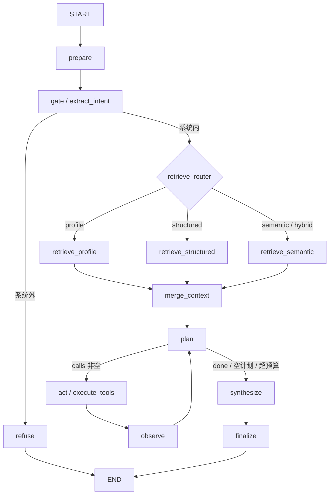

# Mirror 对话系统 LangGraph 化 — 设计与实施文档

> 日期：2026-10-20
> 状态：设计稿，未开工
> 范围：把「对话 Agent 循环」从 Java 驱动改为 Python LangGraph 驱动
> 前提：Java 侧新增一个内部 gRPC 回调服务（执行工具 / 检索）
> 原则：不一次性替换，先影子对照，用数据决定切换

---

## 0. 一句话结论

现在不是一个「半套 agent」，也不是「两套 agent」：**决策在 Python（`PlanNextStep`），执行与状态在 Java（`ToolOrchestrator.loopAndExecute` + `ChatServiceImpl`），循环被两个服务分着持有。**

本次迁移要做的事只有一件：**把循环的控制权收进 Python 的一张图里，Java 退化成“工具执行器 + 数据访问层”**。检索（pgvector SQL）、8+ 个工具、审计、会话存储都不搬。切换方式是先跑影子对照，数据赢了再切。

预计工期：**2–3 周**（不含论文写作）。超过 3 周说明范围失控，应停下来砍功能。

---

## 1. 现状事实（代码坐标）

### 1.1 Java 对话主链路

文件：`Mu-mirror-B/src/main/java/org/xianshen/mumirrorb/service/impl/ChatServiceImpl.java`

`chat()`（125–225 行）顺序：

1. `resolveSession` 建/取会话（131）
2. user 消息落库（134）
3. 词典 query 匹配 + `ExtractIntent` gRPC（137–140）
4. `route` 四选一：PROFILE / STRUCTURED / SEMANTIC / HYBRID（140）
5. 若 `vault.chat-loop-enabled=false`，走旧 `planAndExecute`（回滚路径，147–159）
6. 发 `meta` SSE（160–162）
7. `retrieve(userId, route, intent)` 四路检索，**一次只走一路**（164–165）
8. 若循环开启，`toolOrchestrator.loopAndExecute(...)`（171–195）
9. 检索空且工具无有效数据 → 三档兜底文案（203–207）
10. `streamAnswer(...)` 调 Python `Chat` 流式，透传 `thinking` / `delta`，结束落库 assistant + sources + tools_used + vault_refs（230–284）

SSE 事件名：`meta`、`thinking`、`delta`、`sources`、`vault_refs`、`done`、`error`。

### 1.2 现有 Agent 循环

文件：`Mu-mirror-B/src/main/java/org/xianshen/mumirrorb/tools/ToolOrchestrator.java`

- `loopAndExecute`（242–462）
- 每一步：`planOneStep`（474–504）→ Python `PlanNextStep` 流式 → 终帧 `calls/done`
- Java 执行工具（317–386），写 `tool_calls` 审计
- 六条终止条件（219–227）：
  1. 模型 `done=true`
  2. 终帧 `calls` 为空
  3. `step > vault.max-loop-steps`
  4. 循环累计耗时 > `vault.loop-budget-ms`
  5. 同工具 + 同参数指纹重复（防原地打转）
  6. 单步流中断 / 终帧缺失 / 解析失败 → **不重试**，带着已有结果退出
- 循环末尾有一次窄口径 `recall_item` 兜底补读（400–453），这是实测结论，不是理论设计

### 1.3 Python 侧

- `services/plan_service.py`：`PlanTools`（旧单次规划）与 `PlanNextStep`（流式单步决策）
- `services/chat_service.py`：`ExtractIntent`、`Chat`（流式）、工具结果渲染、假引用过滤、sources 解析
- `llm/`：自研的 OpenAI 兼容 / Anthropic 双协议客户端，流式返回 `(kind, text)` 二元组（`thinking` / `content`）
- 无状态铁律：不连库、不存会话；`LlmConfig` 随每次请求到达
- 现有配置：`config.py` 的 `plan_tools` 段（max_calls=2 / max_tools=20 / max_tool_chars=2000 / thinking_budget_tokens=0）

### 1.4 现有工具（`tools/impl`，注册表自动收集）

| 工具 | 读/写 | 说明 |
|---|---|---|
| `search_records` | 读 | 元数据 + 关键词检索日记 |
| `get_stats` | 读 | 聚合统计 |
| `get_profile` | 读 | 画像快照 |
| `get_coverage` | 读 | 认知边界（数据覆盖范围） |
| `get_glossary` | 读 | 个人词典 |
| `compare_snapshots` | 读 | 快照对比 |
| `find_item` | 读 | vault 文件查找 |
| `recall_item` | 读 | vault 文件正文摘录 |
| `save_item` | **写** | 对话内保存/关联文件 |

> 设计文档曾写「8 工具」，当前 `tools/impl` 实际 9 个。以 `ToolRegistry` 启动日志为准，不要照抄旧数字。

### 1.5 关键配置（`application.yml`，前缀 `vault.*`）

```yaml
vault:
  plan-tools-timeout-ms: 120000   # 单步规划超时
  chat-loop-enabled: true         # 回滚闸
  max-loop-steps: 4
  loop-budget-ms: 180000
  plan-history-rounds: 6          # 规划器历史窗口（答案侧 HISTORY_ROUNDS=3）
mirror:
  sse-timeout-ms: 600000
```

### 1.6 协议现状

- `mirror_chat.proto`：`ExtractIntent` / `Chat(stream)` / `PlanTools` / `PlanNextStep(stream)`
- `common.proto`：`LlmConfig` / `GlossaryTerm` / `ToolSpec` / `ToolResult`；`RetrievedChunk` 在 `mirror_chat.proto`
- 调用方向：**Java → Python 单向**

---

## 2. 目标架构

### 2.1 职责边界

| 层 | 负责 | 不负责 |
|---|---|---|
| Java | 会话、消息落库、鉴权、SSE 转发、pgvector 检索 SQL、工具执行、审计、vault | 循环控制流、终止判断、规划 |
| Python 图 | 意图门、检索编排、规划、工具调用决策、终止策略、生成回答 | 数据库、用户配置持久化、原始数据存储 |

**调用方向变为双向**：

```
前端 --SSE--> Java --RunAgent(stream)--> Python 图
                  <--ToolCall/Delta/...--
                  <--ExecuteTool/Retrieve--
```

### 2.2 目标图



阶段划分：

- **阶段 A（等价图）**：只把现有流程原样画出来，检索仍单路，工具仍同一批，不新增行为。目标是「结果与旧链路一致」。
- **阶段 B（利用图的能力）**：并行检索、显式终止原因、写入前 `interrupt`、跨请求断点恢复。

**不要在第一阶段就改行为。** 否则你无法判断差异是图带来的，还是新功能带来的。

---

## 3. 契约设计

### 3.1 RunAgent（Python 提供，Java 调用）

```protobuf
service AgentRunner {
  rpc RunAgent(RunAgentRequest) returns (stream AgentEvent);
}

message RunAgentRequest {
  string user_id = 1;
  string session_id = 2;          // = LangGraph thread_id
  string question = 3;
  LlmConfig llm_config = 4;       // 运行时上下文，不进 checkpoint
  repeated GlossaryTerm glossary = 5;
  repeated ToolSpec tools = 6;    // Java 注册表快照（Python 不硬编码）
  repeated ChatMessage history = 7;
  string engine = 8;              // graph / shadow（旧路径不经过本接口）
  int32 max_steps = 9;
  int64 budget_ms = 10;
  bool shadow = 11;               // true = 只记录，不把输出交给前端
}

message AgentEvent {
  oneof event {
    Meta meta = 1;                // route / session_id / tools_used
    ThinkingDelta thinking = 2;
    AnswerDelta delta = 3;
    ToolCallStarted tool_call = 4;
    ToolExecuted tool_result = 5;
    Sources sources = 6;
    VaultRefs vault_refs = 7;
    InterruptRequest interrupt = 8;
    StopInfo stop = 9;            // stop_reason: done / empty_calls / max_steps / budget / loop / error
    ErrorInfo error = 10;
    Done done = 11;
    NoMaterial no_material = 12;  // 交给 Java 走三档兜底文案
  }
}
```

要点：

- `stop` 事件显式携带终止原因，这是旧实现做不到的。写入 trace，不进回答。
- `no_material` 让 Java 保留现有三档兜底（新用户 / 没匹配上 / 情绪倾诉），**第一阶段不要把兜底文案搬进 Python**。
- `shadow=true` 时 Python 照样跑完整图，但 Java 丢弃 `delta/sources`，只记录事件流。

### 3.2 ExecuteTool（Java 提供，Python 调用）

```protobuf
service AgentToolService {
  rpc ExecuteTool(ExecuteToolRequest) returns (ExecuteToolReply);
}

message ExecuteToolRequest {
  string user_id = 1;
  string session_id = 2;
  string call_id = 3;       // 幂等键
  string tool = 4;
  string args_json = 5;
  bool shadow = 6;          // true 时拒绝写工具
}

message ExecuteToolReply {
  string call_id = 1;
  string tool = 2;
  string summary = 3;
  string payload_json = 4;
  bool success = 5;
  int64 latency_ms = 6;
}
```

实现要点：

- 直接复用 `ToolRegistry.get(name)` + `ToolExecutor.execute(userId, args)`，**不要重写工具**。
- 审计继续写 `tool_calls`；影子模式写日志或加 `shadow` 标记，避免污染论文数据。
- 写工具（`save_item`）在 `shadow=true` 时直接返回 `success=false, summary="shadow 模式跳过写操作"`。
- 未知工具、参数解析失败：返回 `success=false`，不抛异常（与现有「跳过该步」一致）。

### 3.3 Retrieve（Java 提供，Python 调用）

建议**按路径拆成独立 RPC**，让图能真正并行：

```protobuf
service AgentRetrievalService {
  rpc RetrieveProfile(RetrieveRequest) returns (RetrieveReply);
  rpc RetrieveStructured(RetrieveRequest) returns (RetrieveReply);
  rpc RetrieveSemantic(RetrieveRequest) returns (RetrieveReply);
}

message RetrieveRequest {
  string user_id = 1;
  string question = 2;
  string rewritten_query = 3;
  string content_type = 4;
  repeated string moods = 5;
  string time_range = 6;
  int32 limit = 7;
}

message RetrieveReply {
  repeated RetrievedChunk chunks = 1;
  bool degraded = 2;      // 例如向量缺失、时间衰减关闭
  int64 latency_ms = 3;
}
```

- SQL、时间衰减、软删除过滤、`embedding IS NULL` 排除，全部复用现有 `ChatSearchMapper` / `retrieve*` 实现。
- 阶段 A 只调用被路由选中的那一个 RPC，保持行为等价。
- 阶段 B 才允许同时调用多个 RPC 并 `merge`，同时用评测集验证 Hit@5 / MRR 是否真的提升。

### 3.4 Java 侧新增 gRPC Server

这是本次迁移**唯一的结构性新增**：

- 在 Java 启动一个内部 gRPC server（`grpc-spring-boot-starter` 或原生 `grpc-netty`），端口例如 `10004`，只绑定内网/Docker 网络。
- 注册 `AgentToolService`、`AgentRetrievalService`。
- 简单鉴权：metadata `x-internal-token`（配置项注入，Python 与 Java 共用）。毕设规模不必上 mTLS。
- 如果不想加 gRPC server，替代方案是 Python → Java 内部 REST + service token；**不推荐**，因为会同时维护两套序列化与错误映射。

---

## 4. AgentState 设计

```python
class AgentState(TypedDict, total=False):
    # 输入（Java 每次传入）
    user_id: str
    session_id: str
    question: str
    history: list[dict]
    route: str
    intent: dict            # content_type / moods / time_range / rewritten_query
    glossary: list[dict]
    tools: list[dict]

    # 运行态
    chunks: list[dict]      # 统一为 dict，禁止存 protobuf 对象
    tool_results: list[dict]
    steps: int
    fingerprints: list[str]
    stop_reason: str | None
    answer: str
    sources: list[dict]
    vault_refs: list[dict]

    # interrupt 用
    pending_tool: dict | None
    resume_decision: str | None

    # 影子 / 观测
    trace: list[dict]
    started_at: float
```

硬性规则：

1. **`LlmConfig`（含 api_key）绝不能进 state。** 用 `Runtime[Context]` 或每次 invocation 的 `configurable` 传递；checkpoint 只保存运行态。
2. **所有值必须可 JSON 序列化。** protobuf → dict 在边界转换；时间用 ISO 字符串；集合用 list。
3. `fingerprints` 用 list 存，判断时转 set；不要直接把 `set` 放进 state。
4. `trace` 只放轻量事件（节点名、耗时、工具名、stop_reason），不要放完整 payload，否则 checkpoint 膨胀。
5. 语言模型客户端沿用 `llm/factory.create_llm`，**不要为了 LangGraph 引入 `langchain-anthropic` / `langchain-openai`**。图的职责是编排，模型抽象继续用现有双协议封装。

---

## 5. 节点实现映射

| 节点 | 复用 | 新写 |
|---|---|---|
| `prepare` | Java 已建会话/落库，Python 只整理 history | 组装 state |
| `gate` | `prompts/intent.txt` + `llm.json_task` | 抽出 `extract_intent()` 纯函数；可加 scope 三档（系统内/不确定/系统外） |
| `retrieve_*` | Java `retrieveProfile/Structured/Semantic` | 包成 gRPC 回调 |
| `merge_context` | 检索结果排序、限 5 条 | 合并去重、按 score |
| `plan` | `plan_service.sanitize_calls` / `resolve_done` / `prompts/plan_tools.txt` | 图节点包装；thinking 用 `StreamWriter` 外推 |
| `act` | `ExecuteTool` RPC + `ToolRegistry` | 指纹去重、步数/预算检查、写工具拦截 |
| `observe` | — | 累积 `tool_results`，更新 `steps` |
| `synthesize` | `prompts/chat.txt` + `llm.chat_stream` + 假引用过滤 | 抽出 `stream_answer()` 纯函数，供旧 servicer 与图节点共用 |
| `finalize` | Java 侧落库 | 返回 sources/vault_refs 事件 |

### 5.1 必须做的纯函数抽取（M0）

为了让新旧实现行为一致，先把现有单次逻辑抽成可复用函数，**这一步不改任何行为**：

- `services/intent_service.py`：`extract_intent(query, glossary, llm_config) -> dict`
- `services/answer_service.py`：`build_answer_prompt(...)` + `stream_answer(...)`
- `services/plan_service.py`：已有 `sanitize_calls` / `resolve_done`，补一个 `plan_next_step(...) -> PlanStep`
- `services/tool_render.py`：把 `_format_tool_results` 等留在原处或迁出，保证两边共用

旧 servicer 改为调用这些函数，357 个 Python 测试必须全绿。**这是整个迁移的地基，先做且单独提交。**

### 5.2 终止条件在图里的落点

```python
def should_continue(state) -> str:
    if state.get("stop_reason"):
        return "synthesize"
    if state["steps"] >= max_steps:
        return "stop_max_steps"
    if elapsed(state) > budget_ms:
        return "stop_budget"
    if not state["pending_calls"]:
        return "synthesize"          # 空计划
    if state["done"]:
        return "synthesize"          # 模型自评够了
    if fingerprint_duplicated(state):
        return "stop_loop"
    return "act"
```

`stop_*` 节点只做一件事：写 `stop_reason`，然后进 `synthesize`。这样「为什么停」第一次成为可观测数据。

### 5.3 流式实现

Python gRPC server 当前是**同步 server（ThreadPoolExecutor）**，不要为了图改成异步 server（会牵动所有 servicer）。

用 LangGraph 的 **custom stream + StreamWriter**：

```python
def synthesize(state, runtime, writer: StreamWriter):
    for kind, text in llm.chat_stream(messages):
        if kind == "thinking":
            writer({"type": "thinking", "text": text})
        else:
            writer({"type": "delta", "text": clean(text)})
    ...
```

```python
for mode, chunk in graph.stream(inputs, config, stream_mode=["custom", "updates"]):
    if mode == "custom":
        yield to_sse(chunk)
```

- 规划节点的 thinking 同样用 `writer` 外推，不能攒完再发（这是 2026-09-21 联调的核心结论）。
- 假引用过滤 `_FakeCiteFilter` 必须在 `synthesize` 里逐块执行，不能等全文生成完再过滤。

### 5.4 interrupt（阶段 B）

- 写工具（当前 `save_item`）执行前调用 `interrupt({"tool": name, "args": args, "call_id": id})`。
- Java 把 `interrupt` 事件转成前端确认卡；用户确认/取消后，用同一 `session_id` 再调 `RunAgent`（或单独的 `ResumeAgent`）并带 `resume` 值。
- **必须幂等**：恢复时按 `call_id` 去重，避免用户双击写两次。建议 `save_item` 增加 `request_id` 去重或内容哈希去重。
- checkpoint 存储：开发用 `SqliteSaver`；部署可换 `PostgresSaver`（已有 PG）。按 `thread_id=session_id` 存。
- 清理策略：每次会话完成后保留最近 N 个 checkpoint，或按时间 TTL 清理；毕设规模不要无限增长。

---

## 6. 影子对照方案

### 6.1 开关

```yaml
chat:
  engine: legacy        # legacy / graph / shadow
  shadow-sample-rate: 0.2
```

- `legacy`：完全不动，默认值。
- `shadow`：旧路径正常返回用户；同时异步跑图，结果**丢弃**，只记录。
- `graph`：图版返回用户。

按 `user_id` 哈希做灰度，不要全量。

### 6.2 影子期红线

1. **不执行写工具。** `shadow=true` 时 `save_item` 直接跳过。
2. **不写 `tool_calls` 审计。** 影子数据单独落 `agent_shadow_runs` 表或日志文件，避免论文数据被污染。
3. **不落 assistant 消息。** 影子回答不能进 `conversation_history`。
4. **限制预算。** 影子跑图会翻倍消耗 token；只对 20% 请求采样，且用固定便宜模型做对比。
5. **输入脱敏。** 录制的对照语料只存本地，不进公开博客。

### 6.3 指标（提前定死）

| 指标 | 定义 |
|---|---|
| 终止原因分布 | done / empty_calls / max_steps / budget / loop / error |
| 平均步数 | 工具调用步数 |
| 延迟 | p50 / p95，从 RunAgent 开始到 done |
| token | 输入 + 输出，按角色分 |
| 工具成功率 | success / total |
| 无材料兜底率 | 触发 `no_material` 的比例 |
| 引用覆盖率 | 回答中被引用的来源数 / 可用来源数 |
| 人工评分 | 30 条盲评，1–5 分，评「是否回答了问题、是否有证据」 |

**不要用「回答相似度」当主指标。** 两版措辞必然不同，相似度低不代表新版差。人工盲评 + 事实核对更可靠。

### 6.4 对照语料

- 30–50 条真实提问，覆盖：画像类、结构化类、语义类、混合类、文件类、无材料类、多轮追问、情绪倾诉。
- 每条记录：用户、会话、问题、当时的路由、旧链路答案、旧链路 trace。
- 对照组固定模型、固定 temperature=0、固定 prompt 版本，并记录 prompt hash。

---

## 7. 实施里程碑

### M0 纯函数抽取（1–2 天）

- `intent_service.py` / `answer_service.py` / `plan_next_step()`
- 旧 servicer 改为调用新函数
- 验收：357 个 Python 测试全绿；E2E 行为无变化

### M1 契约与 Java 回调服务（2–3 天）

- proto 新增 `RunAgent` / `ExecuteTool` / `Retrieve*`
- Java 起内部 gRPC server，绑定工具与检索
- 验收：Python 用桩调用 `ExecuteTool("search_records")` 能拿到真实结果；`RetrieveSemantic` 结果与现有检索一致

### M2 等价图（3–5 天）

- `agent_core/`：state / graph / nodes / edges
- 阶段 A：单路检索、同一套工具、同一套终止条件
- 验收：30 条语料上，路由一致、工具调用集合一致、sources 子集一致、无崩溃

### M3 影子运行与指标（2–3 天）

- `engine=shadow`、采样、独立记录
- 指标脚本：读 `agent_shadow_runs` 输出对比表
- 验收：同一批输入跑出可读的对比报告

### M4 图能力增强（3–5 天，仅当 M3 数据不劣于旧版）

- 并行检索 + merge
- `stop_reason` 进 trace 与前端调试面板（可选）
- `interrupt` 写确认 + 幂等
- 验收：并行检索在评测集上不降 Hit@5/MRR；写确认可恢复

### M5 决策（1 天）

- 数据赢：`engine=graph`，旧循环保留一个版本后删除
- 数据平/输：保留 `legacy`，写「为什么图编排在此场景没有赢」的结论与数据

---

## 8. 明确不做

- 不把 pgvector / SQL 搬进 Python
- 不重写 8+ 个工具
- 不删旧 `ToolOrchestrator`（直到 M5 决策）
- 不改前端协议（SSE 事件名保持不变）
- 不在这次迁移里加联网搜索、scope 拒答、本地 grep
- 不为 LangGraph 引入 LangChain 模型封装；继续用现有 `llm/` 双协议客户端
- 不做多 agent 圆桌、聊天室、语音等扩展

> scope 拒答（“只回答系统内的问题”）是**产品决策**，不是本次迁移的一部分。它可以在 `gate` 节点里作为后续增量加，但不要和迁移混在一起，否则无法判断对照数据的变化来源。

---

## 9. 风险清单

| 风险 | 表现 | 应对 |
|---|---|---|
| 双向调用超时 | Python 调 Java 卡住，SSE 断 | 每次回调设 deadline；节点级 timeout 与客户端重试不要叠加（会相乘） |
| checkpoint 序列化 | protobuf / set / datetime 存不进去 | state 只放 dict/list/str/int/float；边界转换 |
| 密钥泄漏 | api_key 进 checkpoint DB | LLM 配置走 runtime context，绝不进 state |
| 双重重试 | gRPC 客户端重试 × 节点 RetryPolicy | 只在一层重试；回调失败返回 `success=false` 让图决策 |
| 写操作重复 | interrupt 恢复后写两次 | `call_id` 幂等 + 内容哈希去重 |
| 影子污染审计 | 论文数据混入两套路径 | 影子单独落表，不写 `tool_calls` |
| 成本翻倍 | 影子期双跑 | 采样 20%，固定便宜模型，离线回放优先 |
| 流式体验退化 | thinking 攒完才发 | 所有增量用 `writer` 实时外推，逐块测试 |
| 行为回归 | 图版漏掉 `recall_item` 兜底、假引用过滤、日期感知 | 把这些作为 M2 验收项逐条核对 |

---

## 10. 新对话开场白（直接复制）

```
我们在 Mu-mirror-AI（C:\Users\cheng\Desktop\claude\own\Mu-mirror-AI）里做对话系统的
LangGraph 迁移。设计文档在 docs/2026-10-20-chat-agent-langgraph-migration.md，先完整读它。

当前状态：设计已完成，代码未开工。第一步是 M0（纯函数抽取），不是直接写图。

请先做这几件事再动手：
1. 读 docs/2026-10-20-chat-agent-langgraph-migration.md
2. 读 services/chat_service.py、services/plan_service.py、server.py、config.py
3. 读 Java 侧 ChatServiceImpl.java 的 chat()/streamAnswer()、ToolOrchestrator.java 的
   loopAndExecute()、mirror_chat.proto、common.proto、application.yml 的 vault 段
4. 确认现有测试基线：python -m pytest tests/ -q

约束：
- 不一次性替换旧循环；保持 chat-loop-enabled 回滚路径
- LlmConfig（含 api_key）不进 state / checkpoint
- 不把检索和工具执行搬进 Python
- 每完成一个里程碑先跑测试，再进入下一个
```

---

## 11. 验收总表

| 里程碑 | 验收 |
|---|---|
| M0 | 357 Python 测试全绿；E2E 行为无变化 |
| M1 | 桩调用 `ExecuteTool` / `Retrieve*` 返回真实数据；与旧路径一致 |
| M2 | 30 条语料：路由一致、工具集合一致、sources 子集一致、零崩溃 |
| M3 | 生成终止原因 / 步数 / 延迟 / token / 工具成功率对比表 |
| M4 | 并行检索不降 Hit@5/MRR；写确认可中断可恢复且幂等 |
| M5 | 切换或放弃的书面结论 + 数据 |

---

## 12. 与论文的关系

这次迁移本身就是论文素材，可作为「架构演进与对照实验」章节：

1. 手写循环 vs 图编排：可观测性（终止原因）、扩展成本、延迟与 token 对比
2. 单路路由检索 vs 并行多路检索：Hit@5 / MRR / 延迟
3. 无中断 vs `interrupt` 写确认：误写率 / 用户确认率
4. 负结果同样可写：如果图版没有赢，说明「编排框架的收益取决于控制流复杂度」，这比强行吹胜利更可信

> 注意：论文里不要写「重写后更优雅」，只写可复现的数字和取舍。
