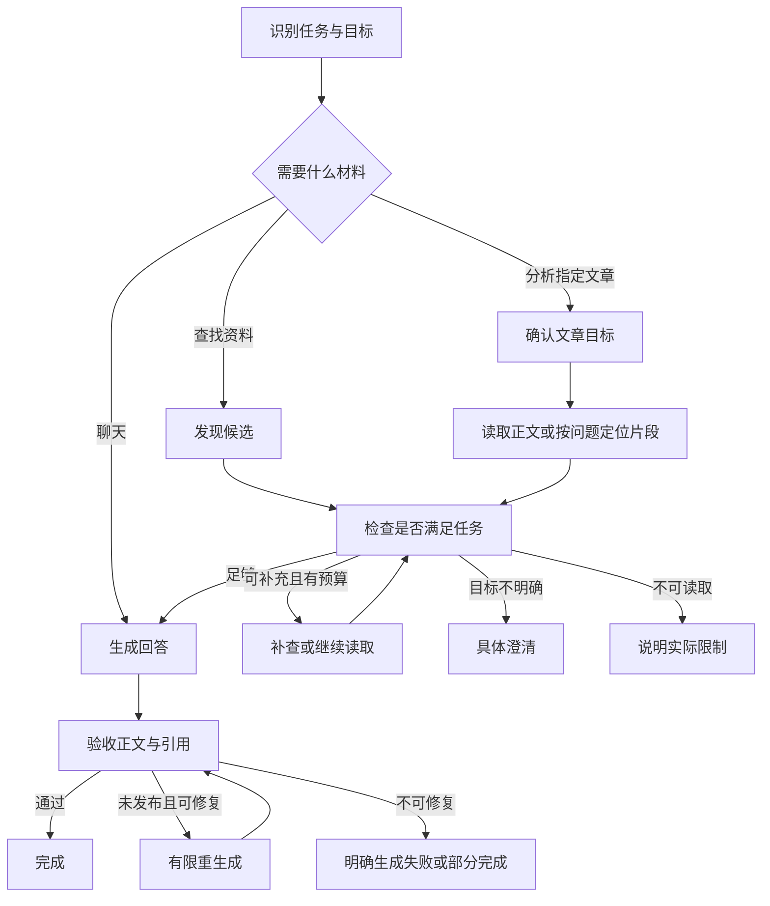

# LangGraph 对话链路诊断与设计建议

日期：2026-10-25。范围：`Mu-mirror-AI/agent_core`、`agent_tools`、`agent_data`、共享模型与回答服务，以及 Java 的 graph_v2 接入边界。没有修改运行时代码、调用真实模型或访问业务数据库。

## 判断

目前三类异常有对应的代码缺口。主问题是：工具协议存在漂移，材料是否足够缺少明确判定，部分错误分支直接绕过回答，最终输出也没有完整的验收机制。

LangGraph 在这里承担节点编排，不会自动保证模型正确调用工具、读取足够正文或完成分析。当前实现使用“文本 JSON 规划器 + 自定义工具执行器 + 独立回答模型”，不是绑定原生工具调用的标准消息循环。这个方案可以成立，但必须由程序维护协议、证据和终止条件。

以下回放证明缺口可达，不代表已确认用户历史每轮异常的实际根因。真实发生频率仍需具体 run 的脱敏轨迹确认。

## 已核实的问题

### 1. 规划指令描述了另一套工具能力

`prompts/agent_plan.txt:9` 要求 `search_records` 使用 `mode`、`record_id`、`offset`，还要求查询待办用 `list_todos`。

但 Python 的 `agent_tools/registry.py` 没有这些参数，也没有 `list_todos`；`agent_tools/read_tools.py:140` 明确拒绝额外字段。其 `query` 实际映射为字符串包含匹配，不是规划指令里描述的语义搜索。Java 旧后端另有支持 mode/offset 的实现，不能把两套能力混用。

后果：模型遵守文字指令也可能得到 INVALID_ARGS。未知工具在 `nodes.py:208` 被直接跳过；如果没有初始材料，最终可能给出“没有足够记录”的兜底，掩盖真正的接口错误。`done=true` 的无效调用还可能不再获得纠错机会。

### 2. 文件候选被当成足够的正文材料

`find_item` 返回文件名、描述、状态等元信息，同时生成 `kind=vault` 的 Evidence，并将 `has_material` 置为 true。`nodes.py:637` 只要看到任意 Evidence 或 has_material 就认为有材料，没有检查问题需要哪种材料。

自动补读只在极窄条件下触发：正文请求、done/empty_calls、没有 recall 记录、恰好一个文件候选。两个候选不会进入目标澄清；recall 返回 EMPTY 后，之前的文件元信息仍能让图进入 synthesize。

因此图允许“没有正文仍进入正文分析”。回放中的模型回答是预设文本，仅证明控制流没有拦住这种状态，不证明真实模型必然编造。

### 3. 正文接口只能读取少量摘录

`agent_data/vault.py:20` 将读取上限固定为 3 段。不带 query 时各取前 300 字；带 query 时各取前 500 字。接口没有页游标、正文覆盖率或可继续读取的位置。

离线调用真实 Repository、替换数据库传输边界：4800 字测试正文最终只返回 900 字。代码的确把正文片段传给了回答模型，但“已读取”不能解释为“读完全文”。对于整体总结、论证分析、结尾判断，当前能力不足。

日记检索也主要返回 segment；初始检索最多 5 段，search_records 最多 20 段且不能翻页。若目标是分析某篇完整日记，需要独立的、遵守原有授权条件的记录内容读取接口。

### 4. 可选工具失败会阻止已有材料被分析

`act` 遇到 UNAVAILABLE/TIMEOUT 设置 read_error；`after_observe` 直接进入 finalize；finalize 输出 failed。

回放先放入有效日记证据，再让文件查找失败，结果为 failed，最终回答模型调用次数为 0。这一条可以直接解释一部分“拿到结果了却没分析”。

应根据失败工具是不是当前任务的必要依赖决定后续行为：可选补充失败时，保留已有证据并说明限制；核心正文读取失败时，明确回答正文无法读取；取消、权限失败和总期限到达分别处理。

### 5. XML 防护是局部过滤，重试也有拼接缺口

`llm/base.py` 对外只提供文本对话；规划器在 `nodes.py:154` 收集文本后 parse_json，没有向模型 API 注册真实 tools。最终回答也只消费文本。

已有过滤器识别若干固定标签，但进入 Markdown 代码围栏后停止检查工具标签。现有测试明确要求围栏里的工具调用示例保留。因此模型把伪调用放进代码块时会原样输出；`<tool_call id="...">` 这样的属性变体也不匹配固定起始标签。

另一个独立问题在 `answer_service.py:794`：一旦发现伪调用就重试，但此前正常文本可能已通过 delta 发给前端。新答案只有与旧答案完全相同的前缀才会去重，否则直接追加。回放得到“结论甲。结论乙。”。这是流式发布与重生成之间缺少替换语义。

不能把所有 XML 示例一律删除：用户确实询问协议或代码时，它们可能是合法内容。工具执行必须只信结构化通道；正文防护需要结合当前任务，并作为最后的防线。

### 6. 成功终态缺少回答验收

回答模型返回空正文时，synthesize 仍设置 outcome=answer，最终发出 completed。现有逻辑也没有验证“用户要求分析，最终是否真的给出分析”。

另外 `finalize` 将 metrics.degraded_reasons 写死为空数组，丢掉了检索阶段已经收集的降级信息。排查时很容易只看到工具成功、run 完成，却看不到材料和答案的状态。

### 7. 运行副本与源码不一致

`scripts/sync_upload.py --check` 实测发现 9 个文件漂移，包括 agent_chat、agent_plan、answer_service、tool_output_guard。

这证明本地存在两份不同的运行代码，不证明当前服务一定从 upload 启动。Jenkins 发布脚本和 Docker 都可以从仓库根目录启动；若使用 upload 手工部署，就可能遗漏最近的输出修复。调试轨迹应明确记录源码提交、提示词版本与运行目录。

## 建议的设计

核心原则：**模型提出下一步，程序根据任务要求验收材料；只有合格材料才能进入分析，只有合格回答才能标记完成。**

适合 Mirror 的主体是有明确业务步骤的工作流，内部保留有限次数的自主检索。LangGraph 官方也区分预设路径的 workflow 与自主决定步骤的 agent；两者可以组合，无需把所有判断都交给自由工具循环。

### 材料要有等级和范围

不要只保留 has_material。建议区分候选元信息、正文摘录、完整正文、统计结果、画像背景，并保存 document_id、读取区间、是否截断、下一页游标与错误状态。布尔值 full_text_loaded 应来自实际读取覆盖情况，不能仅由 digest_status 推导。

任务不同，验收条件不同：列文件只需要元信息；针对某段内容提问可以用相关摘录；全文总结必须覆盖全文，超长文章可分段提炼后汇总。统计零条也是有效结果，不能套用“非空正文”标准。

“继续分析刚才那篇”还需要可信的会话文档目标，不能只依赖旧回答文本里的名称或引用编号。可以由 Java 保存当前文档引用，每轮重新校验权限并传给图；不必仅为这个需求引入第二套 checkpoint 历史。

### 工具协议只有一个可验证定义

先消除当前提示词与 Python schema 的冲突。每个工具的描述、参数模型、执行校验和模型可见定义由同一份契约产生；两套后端可以实现不同能力，但必须各自给出真实能力快照，不能共用超出自身能力的操作说明。

模型调用层增加明确的能力选择：

- 支持原生 function calling 的端点：使用真实工具定义及调用结果消息，保留 call_id、工具参数和结束原因。
- 支持严格结构化输出的端点：可以继续采用独立规划器，但应按 schema 生成并验证计划。
- 两者都不支持的端点：采用文本 JSON 兼容模式，做完整验证和有上限的纠错；不能把它默认为同等可靠。

这三种方式是不同协议适配，不要求同时重建多套图。原生调用也不能代替材料充分性检查或答案验收。

### 回答阶段明确流式发布策略

短回答可以先生成、验收，再发布。长回答若需要实时 delta，应引入 draft_id 与替换/重置事件，使前端和最终持久化能一致采用新版本；或在已发布内容后停止整段重试，只保留原结果并明确失败。具体选择取决于交互要求。

至少要识别：空回答、只有伪工具调用、结束原因为长度截断、引用不存在、正文任务完全没有正文。对于“已经有记录却声称没找到”“只复述工具状态没有分析”等语义问题，用带人工标注的真实模型回放评估；不宜依赖一组关键词正则判断。

### 观测任务状态，而不仅是工具状态

每轮记录 engine、run_id、代码/提示词版本、模型协议能力、节点路由、工具返回状态、候选数量、正文字符数和覆盖范围、回答正文字符数、模型结束原因、修复次数与最终 outcome。避免记录 API key；原文调试内容按已有授权与脱敏要求处理。

分别表达正常回答、材料不足、部分回答、澄清和失败。`stop_reason` 可以记录为什么停止规划，不能单独代表任务成功。

## 建议落地顺序

1. 修正工具契约漂移；无效工具与参数必须有明确反馈；验证已有证据不会因可选工具失败而被跳过；禁止空回答 completed；保留真实降级指标。
2. 增加任务相关的材料检查，区分文件候选与正文，补目标澄清、正文分页和覆盖信息。
3. 升级模型协议适配、处理流式重生成的一致性，并建立真实模型回放集。

保留现有读取授权、Java 写入确认边界和服务端统一落库。现在没有证据表明需要重写另一套 agent 或引入多 agent 系统。

## 验证记录

项目现有 `.venv` 缺少 langgraph、psycopg 和 psycopg_pool，原命令在收集测试时失败。诊断所需依赖安装在系统临时目录，通过进程级 PYTHONPATH 引用，没有改项目环境。LangGraph=1.2.16，psycopg=3.3.6，psycopg-pool=3.3.3；这是定向离线验证环境，不是完整锁文件部署验收。

现有相关测试：`tests/agent_v2/test_graph.py`、`test_evidence.py`、`tests/test_tool_output_guard.py`，**38 passed in 6.92s**。

额外回放使用真实 graph、runner、工具适配器、回答过滤代码；模型与仓库输入为可控替身。正文截断案例调用真实 VaultRepository，仅替换数据库传输边界。

| 回放 | 观察结果 |
|---|---|
| 提示词要求 mode=structured | 工具 INVALID_ARGS，无证据时给材料不足兜底 |
| 已有初始证据，再遇可选工具不可用 | failed，回答模型调用 0 次 |
| 正文任务找到两个文件后结束规划 | recall 0 次，仍调用回答模型 |
| 候选存在但正文未确认 | recall 为 EMPTY，仍调用回答模型 |
| 围栏中的伪工具 XML | 原样进入正文，没有触发修复 |
| 带属性的 tool_call 标签 | 原样进入正文，没有触发修复 |
| 正常前缀后遇伪调用，再生成不同答案 | 旧前缀与新答案直接拼接 |
| 回答正文为空 | completed、answer_text 为空 |
| 4800 字正文读取 | 实际返回 3 段共 900 字 |

九项均复现预设的代码缺口。这不是线上故障率统计，也不是这些问题已修复的声明。运行时代码未修改。

真实服务下一步可按 run_id 对齐模型原始响应、工具返回和节点路由，以确认用户现场分别命中了哪一项。Java 的 graph_v2 选择同时要求 engine=graph_v2 和用户在白名单；应从该轮服务端 meta/run 记录确认，不能只根据界面或启动端口判断。

## 官方参考

- [Workflows and agents](https://docs.langchain.com/oss/python/langgraph/workflows-agents)：工作流与自主 agent 的区别及组合方式。
- [Tools](https://docs.langchain.com/oss/python/langchain/tools)：工具 schema、运行时与结果返回。
- [Structured output](https://docs.langchain.com/oss/python/langchain/structured-output)：原生结构化输出与工具策略的能力边界。
